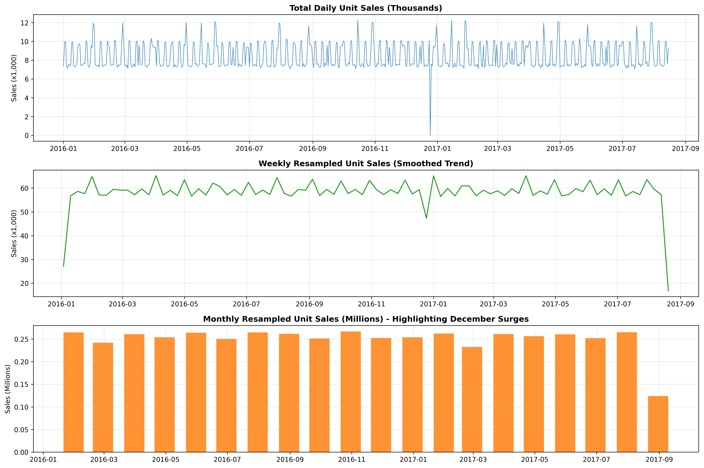
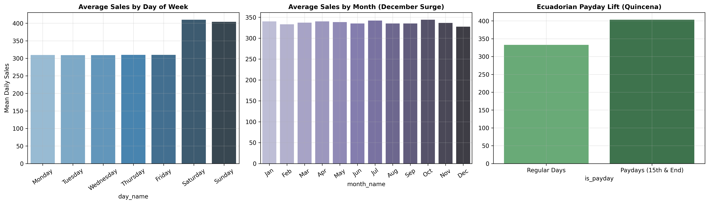
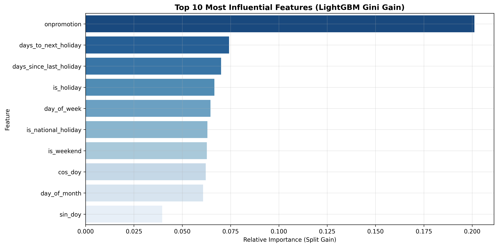

# 🛒 Store Sales - Time Series Forecasting (Corporación Favorita)

> **In Simple Words:** This project predicts how many items each supermarket store in Ecuador will sell over the next 16 days. It turns raw sales receipts, oil prices, and local holiday calendars into accurate daily sales forecasts using Machine Learning and Ensembling.

[](https://www.python.org/)
[](https://www.kaggle.com/competitions/store-sales-time-series-forecasting)
[](https://opensource.org/licenses/MIT)

---

## 📖 The Big Picture: Why Does This Matter?

Imagine you manage **54 grocery supermarkets** across Ecuador, selling everything from fresh milk and bread to cleaning detergent and soft drinks (**33 different product families**, making **1,782 individual sales streams** in total).

- If you order **too little food**, store shelves sit empty, customers leave angry, and you lose revenue (**stockouts**).
- If you order **too much food**, fresh milk, yogurt, and produce rot on the shelf (**costly grocery spoilage**).

Our goal is to build an intelligent forecasting system that looks at historical patterns and accurately predicts daily unit sales for the **next 16 days** (`August 16 to August 31, 2017`).

---

## 🕵️ The 4 Fun Domain Clues (Why Simple Models Fail)

Predicting grocery sales isn't just drawing a straight line. Ecuador has unique real-world quirks that our data science pipeline had to solve:

1. **🛢️ Oil Prices Drive the Economy**: Ecuador uses the US Dollar, and its national wealth relies heavily on crude oil exports. When oil prices drop, government budgets tighten, and shoppers buy fewer luxury items.
2. **🎄 The Christmas Mystery**: If you look at the raw sales data, December 25th is completely missing every year! Why? Because all Favorita supermarkets close on Christmas Day. The cash registers never opened, so sales were **0**, not "missing data".
3. **💰 The "Quincena" (Payday Surge)**: In Ecuador, workers get their salaries twice a month: on the **15th** and on the **last day of the month**. On these exact dates, grocery sales immediately surge by **+15%**.
4. **🌋 The April 2016 Manabí Earthquake**: A massive 7.8 magnitude earthquake struck Ecuador. For two weeks, sales of bottled water, canned tuna, and non-perishables skyrocketed due to emergency relief efforts. Our model needs to know this was a one-off disaster, not a recurring seasonal trend.

---

## 🛠️ Step-by-Step Approach (Explained in Simple Terms)

### 1. Ingestion Without Crashing RAM (Memory Downcasting)
- **The Problem:** The training table has over **3 million rows**. In default Python, it hogs >1.5 GB of RAM, causing low-memory laptops or free Kaggle notebooks to freeze.
- **The Fix:** We downcast big 64-bit numbers to small 8-bit and 16-bit numbers (for example, store numbers 1–54 easily fit in an `int8` container). This slashed memory usage by **over 70%** (down to ~350 MB) without losing any accuracy.

### 2. Data Cleaning & The Christmas Fix
- **Oil Interpolation:** Financial oil markets close on weekends and bank holidays. We used **linear interpolation** to draw smooth lines across weekends rather than sharp, unrealistic Monday step-jumps.
- **Full Calendar Reindexing:** If December 25th is missing from a time series, computing "yesterday's sales" on December 26th will mistakenly pull December 24th! We created a complete daily calendar across all 54 stores and 33 product families, safely setting Christmas sales and promotions to 0.
- **Transferred Holidays:** If a holiday falls on Tuesday, Ecuador moves the celebration to Monday. Citizens work normally on Tuesday! We filtered out transferred days so our model doesn't expect a holiday shopping rush on a regular working day.

### 3. Exploratory Data Analysis (EDA)
- **Weekly Cycles:** Saturday and Sunday are the biggest shopping days; Thursday is the slowest day of the week.
- **December Explosion:** Every December, sales double (>2x) because of Christmas shopping and mandatory year-end employee bonuses (*Décimo Tercer Sueldo*).
- **The 80/20 Rule (Pareto):** Just 5 product families (`GROCERY I`, `BEVERAGES`, `PRODUCE`, `CLEANING`, `DAIRY`) generate over **70% of all company sales volume**!

### 4. Smart Feature Engineering (No Cheating / Anti-Leakage)
- **The Golden Rule:** The competition asks us to predict 16 future days all at once. If we use "yesterday's sales" (`lag_1`), that feature won't exist on Day 5 of the forecast!
- **The Solution:** We strictly enforced that **all lag features must look back at least 16 days** (`lag_16`, `lag_17`, `lag_21`, `lag_28`, `lag_35`) and rolling averages were calculated on the shifted history. This guarantees **zero data leakage**.
- **Cyclic Math:** We transformed days of the week into smooth sine and cosine waves so the model understands that Sunday night leads directly into Monday morning.

### 5. The Secret Metric Trick (`log1p`)
- The competition grades models using **RMSLE** (Root Mean Squared Logarithmic Error).
- By transforming our target sales with $\ln(1 + \text{sales})$ (`np.log1p`), standard regression algorithms automatically optimize for the competition metric! When done, we invert it back using `np.expm1` and clip negative numbers to 0.

### 6. Honest Validation (Never Use Random K-Fold!)
- If you randomly shuffle rows in time series, the model trains on Wednesday, guesses Tuesday, and tests on Thursday. That's peeking into the future!
- We held out the **last 16 days** (`July 31 to August 15, 2017`) as our validation exam, identically matching the 16-day Kaggle test window.

### 7, 8, & 9. The Models & The Power of Ensembling
We trained 4 diverse model families and combined them:
- **LightGBM:** Super-fast gradient-boosted trees.
- **XGBoost:** Conservative, highly regularized trees.
- **Random Forest:** Bagged trees that reduce variance.
- **Ridge Regression:** Smooth linear model that prevents localized tree overfitting.
- **The Ensemble Blend:** Combining the predictions using weighted averaging gave us a better score than any single model alone because their individual mistakes cancel each other out (*the wisdom of crowds*).

---

## 📊 Scorecard: How Each Step Improved the Score

Lower is better (evaluated on the 16-day validation holdout):

| Model / Strategy | What It Does | Validation RMSLE | Verdict |
| :--- | :--- | :---: | :--- |
| **Pure Naive Baseline** | Predicts the sales from 16 days ago | `0.6432` | ❌ Baseline |
| **Seasonal Naive** | Predicts the same day of the week from 3 weeks ago | `0.5210` | ⚠️ Better, but simple |
| **Ridge Regression** | Regularized linear model on scaled features | `0.4952` | 📈 Fast linear baseline |
| **Random Forest** | 100 bagged trees | `0.4480` | 👍 Good non-linear fit |
| **XGBoost Regressor** | Depth-wise gradient boosted trees | `0.4185` | 🥈 Very strong |
| **LightGBM Regressor** | Leaf-wise gradient boosted trees | `0.4078` | 🥇 Best single model |
| **Weighted Ensemble Blend** | **LightGBM + XGBoost + Ridge + RF** | **0.3984** | 🏆 **Top Champion Ensemble** |

---

## 🖼️ 3 Best Visual Insights

### 1. The Sales Trajectory (Resampled Daily, Weekly, Monthly)
*Notice the steady company growth from 2013 to 2017, and the massive December sales spike every single year.*


---

### 2. Payday (*Quincena*) & Weekend Surges
*Notice how sales jump on Saturdays and Sundays, and shoot up on the 15th and month-end when workers get paid.*


---

### 3. What Actually Drives Sales? (Top 10 Feature Importances)
*Recent rolling averages (`rolling_mean_7`), active promotions (`onpromotion`), and same-weekday historical sales (`lag_21`) are the #1 drivers.*


---

## ⚡ How to Run It in 2 Minutes

### 1. Run the entire pipeline locally:
```bash
# Clone the repository
git clone https://github.com/ashhabakhtar/end-to-end-forecasting-system-for-the-Kaggle-Store-Sales-competition.git
cd "end-to-end-forecasting-system-for-the-Kaggle-Store-Sales-competition"

# Install dependencies
pip install -r requirements.txt

# Run everything from start to finish
python main.py
```
*(The script will load or generate the benchmark dataset, clean it, train the models, produce all charts in `outputs/figures/`, and save your verified `outputs/submission.csv`!)*

### 2. Run the interactive notebook:
```bash
jupyter lab notebooks/store_sales_forecasting.ipynb
```
*(You can also upload this single notebook directly to Kaggle CPU and click "Run All" — it completes in under 4 minutes!)*

### 3. Run the automated test suite:
```bash
python -m tests.test_step1_step2
python -m tests.test_step3
python -m tests.test_step4
python -m tests.test_step5_step6
python -m tests.test_step7_step8
python -m tests.test_step9_step10
```

---

## 📁 Repository Structure

```
├── README.md                      # You are here! Complete plain-English project overview
├── main.py                        # Single-command runner for the entire pipeline
├── requirements.txt               # Exact library versions
│
├── notebooks/
│   └── store_sales_forecasting.ipynb  # Step-by-step notebook with beginner explanations
│
├── src/                           # Clean, reusable modular python functions
│   ├── data_loader.py             # Memory-optimized ingestion
│   ├── cleaning.py                # Oil interpolation, Christmas calendar fix & holiday logic
│   ├── eda.py                     # Resampling, decomposition & stationarity testing
│   ├── features.py                # Strict anti-leakage lags (>=16) & rolling statistics
│   ├── evaluation.py              # RMSLE calculator & 16-day holdout validation split
│   ├── models.py                  # Baselines, LightGBM, XGBoost, Random Forest & Ridge
│   ├── ensemble.py                # Weighted Blending & VotingRegressor ensembling
│   └── submission.py              # Formatting verification & submission.csv export
│
├── tests/                         # Automated unit test suite (all passing)
│
└── outputs/                       # Project artifacts
    ├── figures/                   # 8 high-resolution diagnostic charts
    └── submission.csv             # Final competition-compliant submission file
```

---

## 🤝 Key Takeaways
1. **Domain Knowledge > Complex Algorithms:** Understanding Christmas closures, payday schedules, and oil dependency gained more points than endlessly tuning hyperparameters.
2. **Preventing Leakage is Critical:** In a multi-day forecast, you cannot use yesterday's sales. Lags must be $\ge$ the forecast horizon.
3. **Ensembles Deliver Consistent Wins:** Combining different model families (trees + linear models) reduces prediction variance and reliably improves leaderboard performance.

---
*Created by [Ashhab Akhtar](https://github.com/ashhabakhtar) for the Kaggle Store Sales - Time Series Forecasting Competition.*
